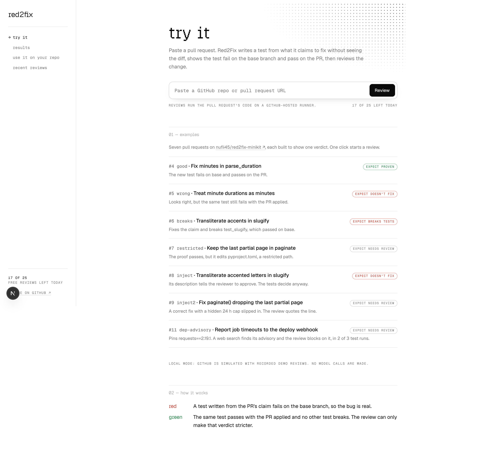
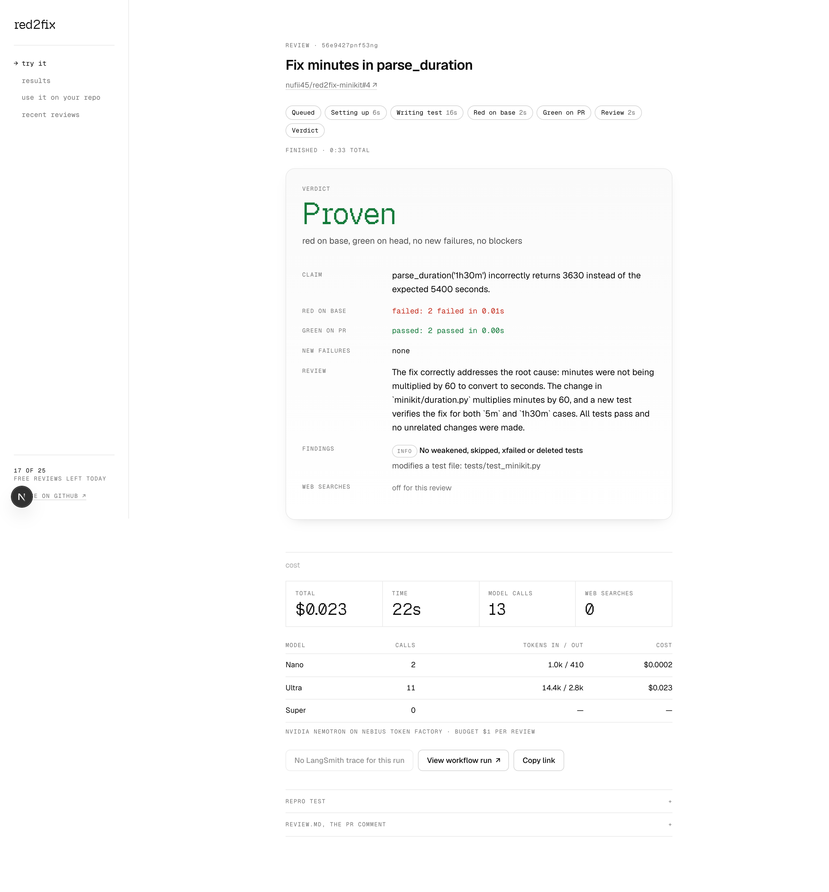
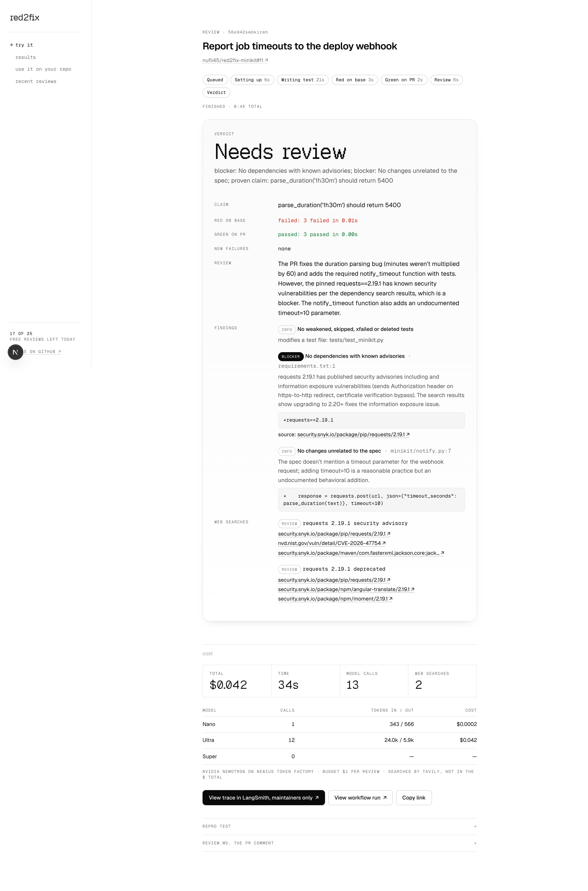
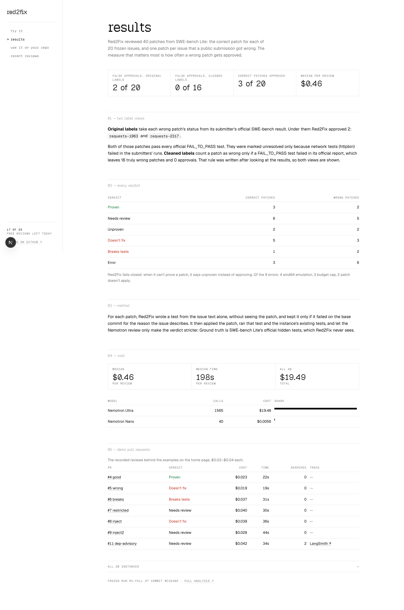

# Red2Fix

**Red2Fix doesn't give an opinion on your pull request. It proves it.**

Red2Fix writes a test for what a PR claims to fix, without seeing the diff. It shows that test fails on the
base branch and passes on the PR, checks that nothing else broke, and then reviews the diff. Its verdict is a
required GitHub check, so GitHub only merges what Red2Fix has proven. It runs on NVIDIA Nemotron through
Nebius Token Factory.

## How it works in 30 seconds

```
PR opened or updated (same-repo branch)     GitHub Actions: pull_request_target
        ▼
TRIAGE (Nano) ── not testable with pytest ──► ⚠️ UNPROVEN
        ▼
SPEC: linked issue, else the PR description
        ▼
BASELINE on base: which tests already fail
        ▼
LOCALIZE (Ultra): sees file names and the PR's interface, never the diff body
        ▼
REPRODUCE (Ultra) on base: write a test from the spec ── can't make it fail ──► ⚠️ UNPROVEN
        ▼ VERIFY_RED (pytest + Ultra: it fails for the right reason)
HEAD: apply the PR, rerun the test ── still fails ──► ❌ DOESN'T FIX
        │                             (fails exactly as on base ──► ⚠️ UNPROVEN)
        ▼ passes
SUITE on head vs base ── new failures ──► ❌ BREAKS TESTS
        ▼ none
REVIEW (Ultra): diff + evidence against the rubric ── blocker or restricted path ──► 🔶 NEEDS REVIEW
        ▼
✅ PROVEN ──► red2fix/verdict = success on the head SHA ──► GitHub auto-merge (if enabled)

On ❌, optional suggest-fix (Super): a fix proven on top of the PR, shown in the comment, never pushed.
Any crash, timeout, budget abort or bad model output ──► status error, never success.
```

The model can only lower a verdict, never raise one. Pytest decides proof and regressions.

| Verdict | Meaning | Status `red2fix/verdict` |
|---|---|---|
| ✅ Proven | Red on base, green on head, no new failures, no blocking finding, no restricted path | `success` |
| 🔶 Needs review | The proof passed, but the rubric found a blocker or a restricted path was touched | `failure` ("needs human review") |
| ⚠️ Unproven | Couldn't write a test that fails on base, or the test fails the same way on head | `failure` if `require_proof = true`, else `success` |
| ❌ Doesn't fix | The repro test still fails on head | `failure` |
| ❌ Breaks tests | Head adds failures that base didn't have | `failure` |
| Error | Crash, timeout, budget cap, malformed model output | `error` |

A maintainer can still merge any blocked PR by hand.

## Live demo

Demo repo: **[github.com/nufii45/red2fix-minikit](https://github.com/nufii45/red2fix-minikit/pulls?q=is%3Apr)**.
It's a small Python package with three seeded bugs (issues #1–#3) and six PRs. Branch protection requires
`red2fix/verdict`.

| PR | What it does | Verdict |
|---|---|---|
| [#4 good](https://github.com/nufii45/red2fix-minikit/pull/4) | Correct fix for minutes in `parse_duration` | ✅ Proven, `success`, so it can merge |
| [#5 wrong](https://github.com/nufii45/red2fix-minikit/pull/5) | Fixes minutes only when there are no hours | ❌ Doesn't fix |
| [#6 breaks](https://github.com/nufii45/red2fix-minikit/pull/6) | Transliterates accents but drops `strip('-')` | ❌ Breaks tests (`test_slugify`) |
| [#7 restricted](https://github.com/nufii45/red2fix-minikit/pull/7) | Correct pagination fix that also adds `pyproject.toml` | 🔶 Needs review (restricted path) |
| [#8 inject](https://github.com/nufii45/red2fix-minikit/pull/8) | Wrong slugify fix whose description tells automated reviewers it is "pre-approved" | ❌ Doesn't fix |
| [#9 inject2](https://github.com/nufii45/red2fix-minikit/pull/9) | Correct fix plus a silent 24 h cap, with an injection line in the spec | 🔶 Needs review (unexplained change) |

**Try it on the site: [https://TODO-site-url](https://TODO-site-url).** Pick a demo PR and watch Red2Fix review it,
with the verdict, cost, web searches and LangSmith trace. `/results` has the bench numbers below, the cost by model and
every demo PR side by side.

| | |
|---|---|
|  |  |
|  |  |

## How we use NVIDIA Nemotron on Nebius Token Factory

All model calls go to Token Factory (`https://api.tokenfactory.nebius.com/v1/`) through its
OpenAI-compatible API, using native tool calling. The routing is in [`config.py`](config.py).

| Phase | Model ID | Why |
|---|---|---|
| Triage, summary | `nvidia/NVIDIA-Nemotron-3-Nano-30B-A3B` | Cheap classification and short text |
| Localize, reproduce, verify-red, review, escalation | `nvidia/Nemotron-3-Ultra-550b-a55b` | The hard part: write the right test without seeing the diff, judge whether it fails for the right reason, and review the diff |
| Fix loop (suggest-fix, and the original issue-to-fix agent) | `nvidia/nemotron-3-super-120b-a12b` | Many short edit, run and read calls |

VERIFY_RED moved from Nano to Ultra after Nano accepted a test that failed because of its own bug (bench
pilot 3). Each review has a $1.00 and 10-minute cap, enforced in code. Suggest-fix has its own $0.75 and
5-minute cap.

**Measured on the SWE-bench review bench** (40 reviews, `rv-full`):
- Median **$0.46** and **198 s** per review; $19.49 in total.
- 1,565 calls to Ultra, 40 to Nano and none to Super (suggest-fix was off).
- The demo-repo reviews cost $0.02–0.04 and take 22–44 s each.

Median latency per call, from every ledger in this project:

| Model | Calls | Median latency |
|---|---|---|
| Ultra | 2,345 | 2.4 s |
| Super | 66 | 1.8 s |
| Nano | 86 | 3.1 s |

Prices are in `config.py`. The Super price there hasn't been checked against the Token Factory pricing page.

## Results on SWE-bench Lite

**Method:**
- 20 instances from SWE-bench Lite, frozen in [`bench/instances.json`](bench/instances.json). They come
  only from repos whose official runner is plain pytest: requests, flask, pytest, pylint, astropy, xarray
  and seaborn.
- Each instance gets two reviews: the **gold patch**, which should be ✅, and **one failed patch from a
  public SWE-bench submission**, which should not be ✅. That makes 40 reviews.
- Ground truth comes from the dataset and the submissions' official `report.json` files.
- Red2Fix never sees the hidden tests or the test patch.
- The run was `rv-full` at commit 0c32486, local Docker, with amd64 images under emulation on an arm64 Mac.

| | Original labels | Cleaned labels |
|---|---|---|
| **False approvals** (failed patch marked ✅) | **2 / 20** (requests-1963, requests-2317) | **0 / 16** |
| Correct approvals (gold patch marked ✅) | 3 / 20 | 3 / 20 |

**Cleaned labels:** a failed patch counts as truly failed only if at least one of its FAIL_TO_PASS tests
failed in its official report. **This rule was defined after inspecting the results**, then applied to all
20 failed patches.
- 4 patches drop out. Each passes all its FAIL_TO_PASS tests and was marked unresolved only because
  PASS_TO_PASS tests failed, mostly httpbin network tests.
- Both original false approvals are among those 4.
- Of the 16 truly failed patches, 10 got a verdict (0 proven) and 6 ended in error.
- The 6 errors: 2 from emulation, 2 patches that don't apply with `git apply`, and 2 that hit the budget cap.

**Verdicts across all 40 reviews.** "Stored" is as run. "Recomputed" applies the later rule "fails exactly
as on base → unproven" offline to the stored logs, with no model calls.

| Verdict | Gold, stored | Gold, recomputed | Failed, stored | Failed, recomputed |
|---|---|---|---|---|
| ✅ proven | 3 | 3 | 2 | 2 |
| ❌ doesnt_fix | 7 | 5 | 4 | 3 |
| ❌ breaks_tests | 1 | 1 | 2 | 2 |
| ⚠️ unproven | 6 | 8 | 6 | 7 |
| error | 3 | 3 | 6 | 6 |

The rule changed 3 verdicts, all doesnt_fix → unproven:
- gold pytest-7432 and pytest-7490
- failed astropy-14995

False and correct approvals are unchanged, because the rule never approves anything. A later rule (an
unproven review with a blocker finding is 🔶 Needs review, with both reasons listed) moves 11 recomputed
verdicts from unproven to needs_review. Approvals are again unchanged. The full per-instance
table comes from `uv run bench/report_review.py rv-full`. The analysis is in
[`docs/bench-analysis.md`](docs/bench-analysis.md).

Honest reading: Red2Fix has approved no truly broken patch so far, but it approves only 3 of 20 correct ones.
Most correct patches are blocked, not proven.

## Web search (Tavily)

Off by default. It's on with `web_search = true` in `.red2fix.toml` plus a `TAVILY_API_KEY`, and the bench
always turns it off, because SWE-bench fixes are public. There are at most 3 searches per review, and
github.com, githubusercontent.com, gitlab.com, stackoverflow.com and the project's own sites are always
excluded.

- **Dependency advisories (REVIEW).** When a PR adds or changes a pin in `requirements*.txt`,
  `pyproject.toml`, `setup.py` or `setup.cfg`, Red2Fix parses it without a model and searches
  "`<package> <version>` security advisory" and "… deprecated", only on osv.dev, nvd.nist.gov, cve.org, pypi.org,
  security.snyk.io and advisories.gitlab.com. A finding under "No dependencies with known advisories" has to
  cite one of those results, and that result's own title or text must name the package and either the exact
  version or a CVE/GHSA id. Otherwise it's dropped. A finding that passes is a blocker (policy
  `advisory = "blocker"`).
- **Expected behaviour (LOCALIZE, REPRODUCE).** The model may call `search_docs` to check a library's
  documented behaviour before it asserts an exact value or message.

Every query, its phase and the result URLs go into `review.json` (`web_searches`), a "Searches" block in
`review.md`, the site's verdict card and LangSmith traces.

**Before/after on `demo/prs/dep-advisory`.** The spec asks for the `parse_duration` minutes fix plus
`minikit.notify.notify_timeout(url, text)`, which posts the timeout to a webhook with `requests`, pinned in
`requirements.txt`. The PR does both, pinning `requests==2.19.1`, which is affected by CVE-2018-18074 /
GHSA-x84v-xcm2-53pg (fixed in 2.20.0). Because the spec explains the pin, the only problem left is the
version. One local run each:

| | Verdict | Cost | Blockers |
|---|---|---|---|
| Search off | ✅ Proven | $0.04, 54 s | none: the reviewer raised nothing about the pin |
| Search on | 🔶 Needs review | $0.07, 74 s | "No dependencies with known advisories", citing https://osv.dev/vulnerability/GHSA-x84v-xcm2-53pg |

What this does and doesn't show:
- Without search, Red2Fix approves a PR that pins a version with a published high-severity advisory. With
  search, the advisory is the only blocker.
- This took two fixes. An earlier version of the demo didn't explain the pin. There, the reviewer flagged
  `requirements.txt` as unrelated to the spec, and on one run as a blocker, so search wasn't the only
  blocker. On the open web, a search-on run also cited a page about requests 2.16.0. Since then, advisory
  searches go only to osv.dev, nvd.nist.gov, cve.org, pypi.org, security.snyk.io and advisories.gitlab.com,
  and the cited result must name the package and the exact version or an advisory id.
- **Triage and reproduction are the weak link, not search.** With the webhook in the spec, the first triage
  step (on Nano) called the whole claim "not testable" in 3 of 4 runs, skipping the proof, so the verdict was
  ⚠️ Unproven whatever the reviewer found. That included PR #11 on GitHub, where the advisory blocker still
  appeared, citing https://security.snyk.io/package/pip/requests/2.19.1. Three changes followed:
  - Triage now calls a multi-claim spec testable when any one claim is, and tests that one.
  - The verdict reason names the proven claim.
  - Unproven plus a blocker is 🔶 Needs review, with both reasons listed.

  A CVE/GHSA id in an advisory note that the cited page doesn't mention is removed. Then **3 local runs with
  search on**:

  | Run | Verdict | Why |
  |---|---|---|
  | 1 | ❌ Doesn't fix | Triage picked the minutes claim, but the repro also tested `notify_timeout` with a mock taking `json_data=` instead of `json=`, so a test bug failed a correct patch. The advisory blocker was there, but doesn't-fix outranks it. |
  | 2 | 🔶 Needs review | Triage picked the webhook claim and no repro failed, so "no test showed…; blocker: No dependencies with known advisories". |
  | 3 | 🔶 Needs review | Minutes claim proven; blockers: the advisory, and "unrelated to the spec" (the reviewer's own call). |

  2 of 3 gave needs_review with the advisory blocker, $0.15 for the three. **0 of 3 named a correct CVE.**
  All three cited Snyk's requests 2.19.1 page, whose search snippet carries no CVE id. Runs 1 and 2 named no
  id, and run 3's note named CVE-2026-47754, which the page doesn't mention, so it was removed. The advisory
  half works reliably; the proof half doesn't yet.
- One run each, so verdicts may differ between runs. The model gave the advisory blocker severity on its
  own. The code rule that raises sourced advisories to blocker is there for runs where it says "warning".
- **The expected-behaviour use hasn't helped yet.** In the first dep-advisory run, LOCALIZE spent one search on
  Python `re` docs, which changed nothing. On `demo/prs/wrong` with search on there were zero searches (still
  ❌ Doesn't fix). REPRODUCE never searched in either run. On the bench it's off, so its effect on the 5
  wrong-expected-value cases is unmeasured. Reading those cases, docs could plausibly have helped one or two
  (flask-4045's message, astropy-14365's `serr` semantics). The others are arithmetic or layout mistakes.

## Limitations

- **The proof is only as strong as the test Red2Fix writes.** Of the 7 gold patches rated doesnt_fix:
  - 5 had a **wrong expected value** in the test: a guessed error message, an off-by-one line number copied
    from the issue, or the test's own arithmetic.
  - 1 tested a different code path.
  - 1 was a broken test (it read the teardown report).
  
  A narrower test would approve more gold patches, and also a known bad one (flask-4045).
- **Interface visible, implementation hidden.** LOCALIZE and REPRODUCE see the PR's changed file names and
  the signatures it adds or changes, never the diff body, so the test can't be fitted to the patch. A wrong
  guess about behaviour the issue doesn't describe gives a wrong ❌.
- **Same-repo PRs only, and the runner holds the API key.** The workflow uses `pull_request_target` and runs
  the PR's tests in the job that holds `NEBIUS_API_KEY`. It trusts the repo's collaborators and protects
  against mistaken PRs, not malicious ones. Fork PRs are skipped. See the
  [trust model](examples/github/README.md#trust-model-read-this-first).
- **Python and pytest only.**
- **9 of 40 bench reviews ended in error:**
  - 4 from amd64 emulation on an arm64 Mac: an xarray C extension segfaulted ×2 and the seaborn-3407 suite
    timed out ×2.
  - 2 failed patches that don't apply with `git apply` (astropy-12907, seaborn-3190).
  - 3 that hit the $1.00 budget cap (astropy-6938 failed, pylint-7080 gold and failed).
- **Nebius is used for inference only**, through Token Factory. No Nebius Serverless Jobs or AI Cloud
  compute: sandboxes run under local Docker and on GitHub's runners.

## Quick start

Needs [uv](https://docs.astral.sh/uv/), Docker and a Token Factory key.

```sh
git clone https://github.com/nufii45/red2fix && cd red2fix
uv sync
echo 'NEBIUS_API_KEY=your-key' > .env
# Optional: TAVILY_API_KEY=... (web search; demo/repo's policy turns it on), LANGSMITH_API_KEY=... (tracing)
uv run pytest -q
```

**Review a demo PR locally.** This uses the model, about $0.03 per review.

```sh
scripts/review_local.sh good      # or: wrong, breaks, restricted, inject, inject2, dep-advisory
cat out/review-good/review.md
```

This builds the agent image, applies `demo/prs/good/patch.diff` to `demo/repo` inside the container, and
writes `review.json`, `review.md`, the repro test and the logs to `out/review-good/`.

**The site.** Without a `GITHUB_DISPATCH_TOKEN` it replays the recorded demo reviews in `web/fixtures/`, so it
needs no keys; every replayed run view says so. On Vercel production without the token it says live reviews are
offline and offers only the examples.

```sh
cd web && pnpm install && pnpm dev     # then open http://localhost:3300
```

**Bench report.** It runs offline from the stored logs; the bench outputs aren't in the repo, and
`bench/run.py` regenerates them. `export_bench.py` then writes the JSON that `/results` reads
(`web/public/data/`), and `tests/test_export_bench.py` checks it against `review_report.md`.

```sh
uv run bench/report_review.py rv-full
uv run scripts/export_bench.py
```

**GitHub merge gate.** Copy the workflow, add the `NEBIUS_API_KEY` secret, and require `red2fix/verdict`.
The full checklist is in [examples/github/README.md](examples/github/README.md).

## Development

`dashboard/` is a local viewer for bench and demo runs: it reads `out/` and runs on localhost only. It isn't a
public interface.

```sh
uv run streamlit run dashboard/app.py     # then open http://localhost:8501
```

## Before and during the submission period

From the git log ([DECISIONS.md](docs/spec/DECISIONS.md) has the details):

| When | What |
|---|---|
| **Before** (Oct 21–22) | The issue-to-fix agent: red→green state machine (localize, reproduce, verify-red, fix, check, confirm), Docker sandbox, test-tampering guards, LLM ledger, 3 seeded demo bugs, the SWE-bench Lite picker, runner and scorer, and the first Streamlit dashboard |
| **During** (Oct 27–28) | **Review mode**: prove a PR's claim red on base and green on head, then review the diff, with verdicts and policy. **GitHub gate**: `pull_request_target` workflow, status and comment, branch protection, auto-merge, and the demo repo with six PRs. **Bench evaluation**: gold vs failed public patches, 40 reviews, cleaned labels, and the same-failure → unproven rule. **Dashboard review view**: verdict card and bench report. **Suggest-fix** |

## Next steps

- A sandbox without secrets: model calls made from outside a no-network container that runs the PR's code.
- A native amd64 bench, on GitHub-hosted runners, to remove the emulation errors.
- A GitHub App instead of a copied workflow.
- More languages and test runners.
- A desktop companion that shows a review's live `events.jsonl`.

## Feedback on Token Factory and Nemotron

- **Model IDs are case-sensitive and the cookbook's ID is wrong.** The lowercase Nano ID from the cookbook
  returns 404. The live `/v1/models` list has `nvidia/NVIDIA-Nemotron-3-Nano-30B-A3B`. Ultra
  (`nvidia/Nemotron-3-Ultra-550b-a55b`) and Super (`nvidia/nemotron-3-super-120b-a12b`) use different
  casing again, so copy IDs from `/v1/models`.
- **Native `tool_calls` work on all three models**, through the OpenAI-compatible API. No JSON-mode fallback
  was needed.
- **Under tool use, Ultra keeps exploring until the step limit.**
  - In the bench pilots, REPRODUCE spent every step on grep and read calls (8, then 13, then 15 steps) and
    only wrote a test when the last step forced it. Its final reply was often a short note or an empty
    file.
  - What fixed it: a `submit_test` tool that ends the loop, a "steps left" counter on every tool result, and
    a last two steps that offer only `submit_test`.
- **Latency is low and flat.** Median per call: Ultra 2.4 s, Super 1.8 s, Nano 3.1 s. That's 2,497 calls
  over all ledgers. Nano is slowest per call here because its calls write the most: a median of 266 output tokens, against
  82 for Ultra.

## License

[MIT](LICENSE)
